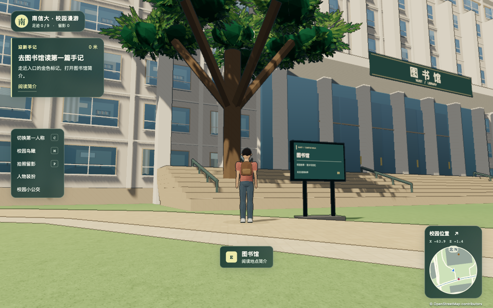

# 南信大校园漫游

用浏览器步行探索南京信息工程大学校园，走近建筑读简介，或从公交站上车看沿途风景。项目使用 Three.js，以白天校园的漫画风呈现建筑、道路与植被，能构建成 Windows 和 macOS 均可离线打开的单个 HTML 文件。



## 直接试玩

在 [试玩版下载页](https://github.com/KKKu07/nuist-campus-walk/releases/tag/baseline-2026-11-20) 下载 `campus-walk.html`，用桌面浏览器打开。首次进入可以选择装扮，起点在图书馆附近。

| 操作 | 用途 |
|---|---|
| WASD、拖动视角 | 步行、环顾和抬头看建筑 |
| C | 切换第一人称与第三人称 |
| E | 在建筑交互范围内读取简介 |
| P | 拍照 |
| 地图面板 | 搜索地标、筛选未读建筑、缩放及选点传送 |
| 公交站交互 | 在十个站点体验双向线路、候车与上下车 |

## 本地开发

在安装了 Node.js 和 npm 的电脑上，克隆仓库后在根目录运行以下命令。本次构建使用 Node.js 24。

```sh
npm install --include=dev
npm run build
```

打开生成的 `dist/校园漫游.html` 即可检查改动。已安装 Google Chrome 的电脑可以继续运行 `npm run test:hud`，验证离线场景中的换装、建筑交互、地图和桌面／竖屏操作。

| 要改什么 | 源码入口 |
|---|---|
| 玩家、镜头和互动 | [game.js](game.js)、[character-creator.js](character-creator.js) |
| 建筑轮廓、构件和场景 | [model.js](model.js)、[building-profiles.js](building-profiles.js)、[osm-data.js](osm-data.js) |
| 操作面板、小地图 | [campus-hud.js](campus-hud.js)、[campus-hud.css](campus-hud.css)、[mini-map.js](mini-map.js) |
| 公交模型、路线与上下车 | [shuttle.js](shuttle.js)、[shuttle-route.js](shuttle-route.js)、[shuttle-controls.js](shuttle-controls.js) |

## 建模与照片采集

建模前先读 [校园漫画风建模规范 PDF](docs/建模规范/南信大校园漫游漫画风建模规范.pdf)，再用 [共用色板](docs/建模规范/共用色板.csv) 对齐墙面、线脚和窗框。规范从位置、轮廓和尺度讲起，并说明材质、描边、光照以及新建筑的接入与走查方法。[图书馆实机参考](docs/建模规范/图书馆实机参考/)提供广场、门廊和侧翼三个对照视角。需要整套离线规范时，可在试玩版下载页取建模协作包。

| 资料 | 用途 |
|---|---|
| [建筑照片采集清单](docs/项目资料/南信大校本部-建筑照片采集清单.xlsx) · [采集编号与场景对照](docs/项目资料/采集编号与当前场景对照.csv) | 以建筑编号建照片文件夹，记录立面朝向、日期和来源，替换前核对场景 ID |
| [B095–B111 定位总览](docs/项目资料/B095-B111-待辨认建筑总览.png) · [交互定位图](docs/项目资料/B095-B111-待辨认建筑定位图.html) | 对照底图现场核名，HTML 下载后可用浏览器打开 |
| [航拍套合图](docs/项目资料/校园布局-鸟瞰套合图.jpg) · [逐栋替换方案](docs/项目资料/南信大校园航拍建模与逐栋替换实施方案.pdf) | 校准建筑位置、朝向、地面与入口 |
| [航拍与布局生成工具](aerial-layout/) | 含原始底图、描绘数据及重算脚本。常规开发直接使用仓库内已生成的地图数据 |

## 同学如何协作

1. 在 [Issues](https://github.com/KKKu07/nuist-campus-walk/issues) 查看 Lead 分配的任务。每项写明负责范围、依赖和验收条件。
2. 从最新的 `main` 创建任务分支，例如 `issue-12-library-facade`。先在自己的分支实现并试玩。
3. 提交 Pull Request，关联 Issue，附改动范围、测试结果和待核验项。画面改动附同一机位的前后截图。Lead 验收后合并到 `main`。

[团队交接](团队交接.md)记录了现有玩法、采集编号差异和首栋建筑的补拍重点。随仓库分发的 Three.js 许可证见 [vendor/THREE-LICENSE.txt](vendor/THREE-LICENSE.txt)。
